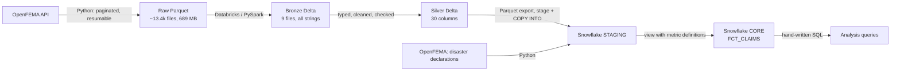

# NFIP Flood Insurance Claims Lakehouse

End-to-end analytics pipeline on FEMA's National Flood Insurance Program (NFIP) data: 2.7 million flood insurance claims (1978 to 2026) and 70,571 disaster declarations, pulled from the OpenFEMA API, processed with PySpark on Databricks, modeled in Snowflake, and analyzed with hand-written SQL.

## Key findings

All amounts are nominal (not inflation-adjusted). Full results and queries: [docs/04_analysis.md](docs/04_analysis.md).

- **Flood losses are extremely concentrated by place.** 78 of 2,941 counties (2.7%) account for 80% of all payouts. Harris County, Texas (Houston) alone is 9.8%; the top 10 counties are 43%.
- **And by event.** The 20 largest state-months account for $58.2B, 65% of the $89.0B paid from 1978 to 2024. Every one of them matches a FEMA disaster declaration (Katrina, Harvey, Helene, Ian, Sandy and others).
- **Catastrophe years drive the totals.** Five of 47 years hold 59% of payouts. 2005 paid $17.8B, 25 times the median year ($710M), and each of those spikes that has a following year was followed by an 81% to 96% drop.
- **Rainfall, not hurricane strength, drives flood losses.** Three of the 20 costliest months were not named storms, and two were tropical storms below hurricane strength (Allison 2001, Imelda 2019), each near $1B.
- **"Low risk" zones are not low cost.** One in four claims (25%) comes from moderate/low-risk flood zones (B, C, X), where flood insurance is usually not required, and those claims average $40.7K, 89% of the high-risk zone average.
- **A typical claim recovers a small share of coverage.** The median paid claim receives 8% to 15% of its coverage; averages are 2 to 3 times the median, pulled up by a few near-total losses.

## Architecture

| Layer | What it does | Where |
|-------|--------------|-------|
| Extraction | Paginates the API 10,000 rows at a time with a stable sort, retries, and a checkpoint so a failed run resumes | `ingestion/extract_openfema.py` |
| Bronze | Lands raw data as Delta, compacting about 13.4k small files into 9 | `spark/01_bronze_claims.py` |
| Silver | Keeps 30 columns, snake_case names, blanks to NULL, real types (`DECIMAL(18,2)` money, dates, booleans), flags 86 negative payments | `spark/02_silver_claims.py` |
| Staging | Snowflake internal stage, `COPY INTO` with column matching by name and load lineage columns | `sql/01_staging/` |
| Core | One view, `FCT_CLAIMS`, defines every metric once | `sql/02_core/`, [docs/02_metrics.md](docs/02_metrics.md) |
| Analysis | Five business questions, six queries | `sql/04_analysis/`, [docs/04_analysis.md](docs/04_analysis.md) |

**Why both Databricks and Snowflake?** At 2.7M rows neither is strictly required (DuckDB profiled the raw data on a laptop). Each is used for what it is designed for: Databricks for file-level processing (compacting about 13.4k files to 9 cut a full count from about 8 s to under 1.5 s, see [docs/03_performance_notes.md](docs/03_performance_notes.md)), and Snowflake for SQL modeling and analysis. The split mirrors a common enterprise setup, and the bronze layer would handle the much larger NFIP policies dataset unchanged.

## SQL highlights

All analysis SQL is hand-written. Techniques used:

- Window functions: `RANK() OVER (PARTITION BY ...)` filtered with `QUALIFY`; running totals with `SUM() OVER (ORDER BY ... ROWS BETWEEN UNBOUNDED PRECEDING AND CURRENT ROW)`; `LAG()` for year-over-year change
- Multi-step CTEs, including a Pareto (80/20) analysis
- `CASE WHEN` segmentation, `MEDIAN` against `AVG` to show skew
- Joins across datasets, with fan-out prevented by aggregating to one row per key (`LISTAGG`) before joining
- Anti-joins two ways (`LEFT JOIN ... IS NULL` and correlated `NOT EXISTS`), with a date-range match
- Divide-by-zero and NULL safety (`NULLIF`, `COALESCE`)

## Data quality

Every layer is reconciled against the one before it, with zero discrepancies:

| Check | Result |
|-------|--------|
| Rows landed vs the API's reported count | 2,721,780 = 2,721,780 |
| Row count at raw, bronze, silver, export file, Snowflake staging, core view | 2,721,780 at every layer |
| `id` uniqueness (Snowflake does not enforce it) | 2,721,780 distinct |
| Values preserved through type casting (non-NULL count before and after each cast) | No values lost; no money rounded |
| NULL, zero and negative building payments, raw vs silver vs Snowflake | 566,351 / 150,348 / 86 at every layer |
| Every claim in exactly one flood zone group | Group counts sum to 2,721,780 |

Profiling queries and findings: [docs/00_profiling.md](docs/00_profiling.md). Load checks: [docs/01_snowflake_load.md](docs/01_snowflake_load.md).

## Scope and known gaps

- **Answered:** where losses concentrate (states, counties, decades), year-over-year volatility, payouts by flood zone risk, and claim spikes against disaster declarations.
- **Not answerable from claims data:** time to close a claim (no close date in the dataset) and underpriced segments (no premium column). Both would need the NFIP policies dataset, which is not loaded yet.
- **Not built yet:** a dashboard, an automated data quality test suite, and the policies dataset.
- Amounts are nominal dollars; cross-decade dollar comparisons overstate recent losses.
- Disaster matching is at state and month level, not county level.

## Reproduce

1. `python -m venv .venv && .venv/bin/pip install -r requirements.txt`
2. `python ingestion/extract_openfema.py FimaNfipClaims` and `python ingestion/extract_openfema.py DisasterDeclarationsSummaries --partition-col fyDeclared`
3. Run `spark/01_bronze_claims.py` and `spark/02_silver_claims.py` in Databricks; download the silver export.
4. `python ingestion/prepare_disasters.py`
5. In Snowflake, run `sql/01_staging/` in order (upload steps in [docs/01_snowflake_load.md](docs/01_snowflake_load.md)), then `sql/02_core/`, then `sql/04_analysis/`.

Credentials go in `.env` (see `.env.example`); data stays in `data/` (gitignored).

## Stack

Python (requests, PyArrow), PySpark, Delta Lake, Databricks Free Edition, Snowflake, SQL, DuckDB (profiling).
